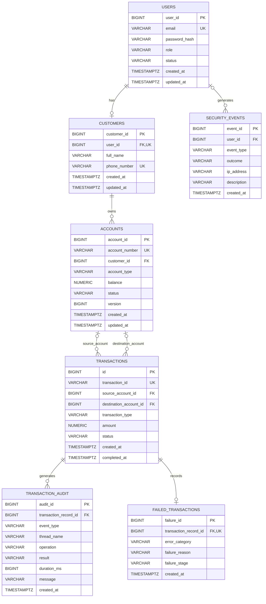

# Entity Relationship Diagram

There are 7 database tables.

## Relationship Notes

1. **USERS → CUSTOMERS:** A user can have zero or one customer profile. Admin users do not require customer profiles.
2. **CUSTOMERS → ACCOUNTS:** A customer can own multiple accounts.
3. **ACCOUNTS → TRANSACTIONS:** An account can participate in multiple transactions as either the source or destination account.
4. **TRANSACTIONS → TRANSACTION_AUDIT:** One transaction can generate multiple audit events.
5. **TRANSACTIONS → FAILED_TRANSACTIONS:** A transaction can have zero or one structured failure record.
6. **USERS → SECURITY_EVENTS:** A user can generate multiple security events. The user reference can be null for unauthenticated events.

## Design Notes

- `transactions.id` is the internal primary key.
- `transactions.transaction_id` is the externally supplied unique identifier used for idempotency.
- `transaction_audit.transaction_record_id` references `transactions.id`, not `transactions.transaction_id`.
- `failed_transactions.transaction_record_id` is unique to allow at most one failure record per transaction.
- `accounts.balance` uses PostgreSQL `NUMERIC` for precise monetary values.
- `accounts.version` supports optimistic locking through JPA's `@Version`.
- Financial transaction history must be preserved; account and transaction relationships should not allow accidental deletion of historical records.
